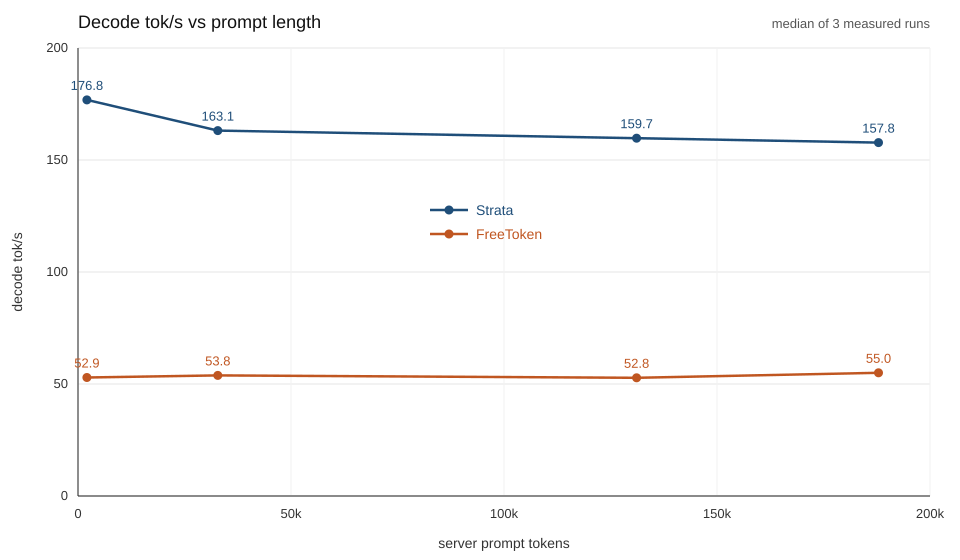

# Strata vs FreeToken, 2026-10-24

Same host (RTX 5090 32607 MiB, power cap 600 W), same client, same prompts. One warmup discarded, then the median of three measured runs. Temperature 0, seed 1, `max_tokens` 512. Every measured run generated 512 tokens. Nothing else was on the GPU.

Prompt text sizes 2048, 32768, 131072, and 187860 become server `prompt_tokens` 2100, 32820, 131124, and 187912 on both engines. Full rows are in [`results.csv`](results.csv). The chart is [`decode-vs-prompt.png`](decode-vs-prompt.png) ([SVG](decode-vs-prompt.svg)).



## Median of the three measured runs

| Prompt tokens | Strata TTFT s | Strata prefill tok/s | Strata decode tok/s | FreeToken TTFT s | FreeToken prefill tok/s | FreeToken decode tok/s |
| --- | ---: | ---: | ---: | ---: | ---: | ---: |
| 2100 | 1.288 | 1630.7 | 176.8 | 1.350 | 1555.8 | 52.9 |
| 32820 | 4.614 | 7112.7 | 163.1 | 5.532 | 5933.2 | 53.8 |
| 131124 | 17.642 | 7432.3 | 159.7 | 18.596 | 7051.4 | 52.8 |
| 187912 | 25.776 | 7290.2 | 157.8 | 27.220 | 6903.5 | 55.0 |

Client prefill tok/s is `prompt_tokens / TTFT`. Client decode tok/s is `512 / (total − TTFT)`. Strata `cached_tokens` was 0 on every row. FreeToken's unit has `enable_cache_report=False`, so that CSV column is blank. The journal is the cache record: all 148 head-to-head prefill lines have `#cached-token: 0`.

Power cap was 600 W on every sample. Strata's measured power max was 387 W at 2K and 588–597 W from 32K up. FreeToken's measured power max was 269 W at 2K, 472 W at 32K, 490 W at 128K, and 546 W at 188K. SM clock was 2932–2940 MHz and memory clock 13801 MHz on both. Strata held about 32182 MiB the whole time. FreeToken held 29920 MiB at 2K and 32140–32144 MiB from 32K up.

## Why the FreeToken 2K TTFT is 1.35 s

On this boot the warm 2K TTFT is 1.350 s (head-to-head median) and 1.338–1.350 s in the breakdown. `2100 / 3500 = 0.600 s`. The measured time is 0.750 s above that 0.600 s prediction. That 0.750 s is a fixed cost, paid before prompt length matters.

Breakdown ([`ttft-breakdown.csv`](ttft-breakdown.csv)), first chat completions after the unit became healthy. `max_tokens` 32. Medians:

| Series | Prompt tokens | TTFT samples s | Median s |
| --- | ---: | --- | ---: |
| Cold, first request | 2100 | 4.348 | 4.348 |
| Warm, identical prompt | 2100 | 1.350, 2.171, 1.338, 1.338, 1.338 | 1.338 |
| Warm, unique prompts | 2100 | 1.338, 1.349, 1.350, 1.350, 1.350 | 1.350 |
| Warm, 64-token user text | 116 | 1.341, 1.339, 1.338, 1.338, 1.338 | 1.338 |

The 116-token median is 1.3379 s. The unique 2100-token median is 1.3502 s. The extra 1984 tokens add 0.012 s. The five 116-token runs themselves only span 1.3377–1.3408 s, so 0.012 s is inside the noise of the floor.

A prefix hit does not remove the floor. Five identical runs logged `#new-token: 52, #cached-token: 2048` (2048 of 2100 served from the radix cache) and their median TTFT was 1.3384 s. The unique runs logged `#new-token: 2100, #cached-token: 0` and took 1.3502 s. `#queue-req: 0` on every short-request prefill line.

Above the floor, TTFT grows with prompt length. Subtract the 1.3379 s floor and the 116 tokens already inside it:

| Prompt tokens | Measured TTFT s | Tokens above 116 | Seconds above 1.3379 | Incremental tok/s |
| ---: | ---: | ---: | ---: | ---: |
| 2100 | 1.350 | 1984 | 0.012 | (inside the floor) |
| 32820 | 5.532 | 32704 | 4.194 | 7798 |
| 131124 | 18.596 | 131008 | 17.258 | 7591 |
| 187912 | 27.220 | 187796 | 25.882 | 7256 |

The long-context slope on this boot is 7,256–7,798 tok/s. The 3.5k tok/s figure is not the slope of these requests. The journal field `input throughput (token/s)` is new tokens divided by time since the previous prefill report, so it includes decode and idle. The 2K harness lines say 190 tok/s for that reason. Back-to-back 10240-token chunks in the same prefill print about 7,400 in that field, which matches the slope above. Those lines are in [`harness-prefill-lines.txt`](harness-prefill-lines.txt) and [`ttft-prefill-lines.txt`](ttft-prefill-lines.txt).

The cold request is 4.3477 − 1.3379 = 3.010 s above the floor. One identical run spiked to 2.171 s. The other four identical runs are 1.3377–1.3503 s. Expert-cache hit and miss were not logged (`moe_collect_stats=False`). That part is unmeasured.

The breakdown decode rates (about 45–73 tok/s at `max_tokens` 32) are not the head-to-head decode numbers. The table above uses `max_tokens` 512.

## Versions and launch commands

Strata, already running. Tree `v0.2.2` at `011c9e600a93bbc9fd451c563501b5831c32bbca`. Engine binary `strata 0.1.47`. Unit `strata-engine.service`:

```
/opt/strata/Strata/.venv/bin/python -m serve.server --engine strata --config /opt/strata/Strata/strata-fp4-local.json --host 0.0.0.0 --port 12345
```

Config engine args: `--pack /mnt/models/qwen/Strata-Qwen3.8-Flash-FP4-Local/pack`, `--native` and `--native-dense-gguf` that tree's `dense.gguf`, `--ple-gguf` `ple-nvfp4.gguf`, `--expert-profile data/expert-profile.bin`, `--expert-cache auto`, `--prefill auto:32768`, `--max-context 262144`, `--kv int8`, `--kv-resident 32768`, `--vram-reserve-mib 512`, `--pool-workers 13`, `--mtp .../mtp/rt`, `--spec 4`, `--spec-min-p 0.5`. Served id `qwen3.8-flash-next-fp4-local`. Strata configs and units live in the sibling repo [Strata-Recipes](https://github.com/Righteous-AI/Strata-Recipes).

FreeToken, the production unit, started unchanged after Strata was stopped. `freetoken version 0.1.3`. Git `3886ceeebf25a0075ea83c7629a19f950a03b3be`. This is the command that was measured:

```
/opt/freetoken/.venvs/ftok/bin/ft serve \
  --model-path /opt/freetoken/models/qwen/Qwen3.8-Flash-Next-NVFP4-ftw-b12x \
  --gpu 0 --host 0.0.0.0 --port 12345 \
  --max-running-requests 1 --memory-ratio 0.898 \
  --moe-cache-auto --moe-strategy offload \
  --num-tokens 200704 --kv-reserve-tokens 200704 --max-seq-len-override 200704 \
  --attention-backend qsa_sparse --quant-backend moe.nvfp4=b12x \
  --moe-prefill-hit-d2d --ple-backend disk --expert-load parallel \
  --cache-type radix --max-prefill-length 10240 --cuda-graph-max-bs 1 \
  --tool-call-parser qwen3_coder --reasoning-parser qwen3
```

Resolved at that boot: `moe_strategy=offload`, `attention_backend=qsa_sparse`, `cache_type=hybrid_radix`, `page_size=64`, `moe_cache_size=4831`, `num_pages=3136` (3136×64=200704), 2.92 GiB free after CUDA graphs. Served id `Qwen3.8-Flash-Next-NVFP4-ftw-b12x`.

Two custom 262144 boots were tried before this unit and were not measured. Cache size 5489 was rejected (`slot limit of 5242`). Cache size 5242 at `memory-ratio 0.95` came up and the first prefill OOM'd a 256 MiB allocation with 93 MiB free. The unit above is the run in the table. Its context cap is 200704. Strata's is 262144. The 187912-token prompt plus 512 generated tokens is 188424, which fits both.

The weights are different packs. Strata's config enables `--spec 4`. The FreeToken unit does not enable speculative decoding. Strata's own log for these requests shows drafts accepted: at 2100 tokens, 235/325, 250/329, and 254/341 on the three measured runs (server decode 168.0, 176.2, 178.3 tok/s). At 187912 tokens the server rates were 156.7, 153.9, 160.2, and 157.2 tok/s, with expert-cache hit rate 95.2–95.8%. FreeToken decode stays at 53–55 tok/s at every length, including the 2K runs, where the card still had about 2.6 GiB free and the sample mean power was 249 W.

One 131124-token Strata request logged `only 17 MiB of VRAM free` and decoded at 149.7 tok/s server-side (client 150.2). That is the low sample in the 159.7 median. It did not fall to a few tok/s.

## Harness

[`harness.py`](harness.py) is the client used for both engines. Head-to-head invocation had no arguments; it writes `results.csv` next to the script and generates its prompts under `./prompts` (set `TOKENIZER` to the model's `tokenizer.json`, `BENCH_URL` to the server). Client on the host, `http://127.0.0.1:12345/v1`, so TTFT is not a LAN measurement. `--breakdown` was the TTFT series only, run before the head-to-head, and was the first chat traffic after load. The FreeToken head-to-head console output is [`freetoken-harness-console.txt`](freetoken-harness-console.txt).

## Files

```
README.md                     # this write-up
results.csv                   # every head-to-head row, both engines
ttft-breakdown.csv            # FreeToken cold / warm / 64-token TTFT series (max_tokens 32)
freetoken-harness-console.txt # harness console, FreeToken head-to-head
harness-prefill-lines.txt     # FreeToken journal prefill lines, head-to-head
ttft-prefill-lines.txt        # FreeToken journal prefill lines, TTFT breakdown
harness.py                    # OpenAI-streaming benchmark client
decode-vs-prompt.png / .svg   # chart
```
